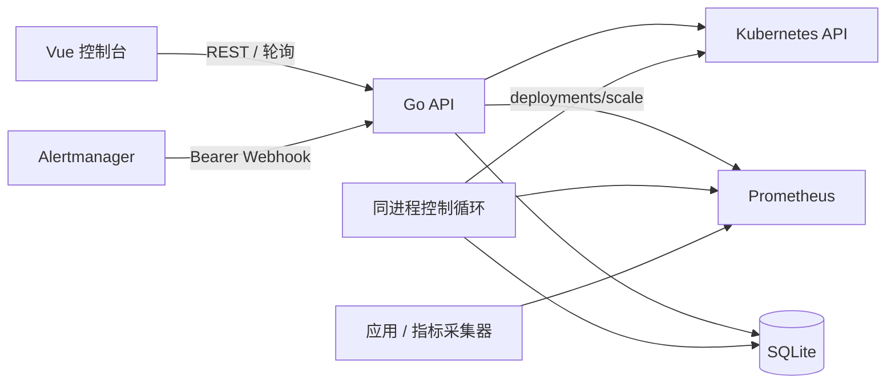

# 架构与边界

## 组件

单个 Go 进程承载 API 与定时控制循环，共享 Kubernetes、Prometheus 客户端和 SQLite。浏览器只访问 Go API，开发时由 Vite 代理。Prometheus 保存时序指标；SQLite 的 `policies`、`operations`、`alerts` 保存 JSON 业务对象及索引列，启动时创建所需表。

## 伸缩闭环

每个 Deployment 最多保存一条策略，支持 CPU 或 RPS 目标值模式：

- CPU：`ceil(当前副本 × CPU 使用比例 / 目标比例)`。
- RPS：`ceil(总 RPS / 单 Pod 目标 RPS)`。

控制循环按策略采样周期读取 Deployment/Scale，检查就绪、滚动更新和 HPA 控制权；按 Deployment selector 获取 Ready Pod，核对指标覆盖与原始采样时间，再计算受上下限约束的候选副本。通过连续触发、缩容稳定窗口和冷却期检查后，带资源版本更新 Scale，并重新读取核对结果。

指标缺失、过期、非有限值、覆盖不全或依赖异常时保守跳过。只写 `deployments/scale`，不直接删除 Pod。手动伸缩要求先暂停自动策略，并检查控制权冲突。HPA 检查不代表能够识别所有外部控制器。

稳定窗口收集所有有效副本建议；重启后重新累计连续次数和稳定窗口，首次缩容需等待完整窗口。已完成伸缩的冷却时间从操作历史恢复。操作保存策略快照、版本、指标采样时间、判断原因及副本结果；写后核对的是 Scale.spec，Pod Ready 需单独观察。

## 告警闭环

Webhook 以 Bearer 密钥校验来源，按全部 labels 与 startsAt 标识一个触发周期。重复通知合并；resolved 为该周期终态，迟到 firing 不会重新激活；新 startsAt 代表再次触发。批量通知在同一事务提交，校验失败拒绝整批。namespace 必须在管理白名单内，workload 标签用于工作负载关联。

告警列表、详情和全量活动/严重统计由 API 提供，前端轮询刷新。告警与伸缩解耦。当前告警查询先读取再筛选分页，适合小规模单实例使用，尚无数据保留策略。

## 运行与安全边界

- 默认监听 `127.0.0.1:8080`；非回环监听要求 `KUBESCALE_ALLOW_REMOTE=true` 且 Webhook 密钥非空。该密钥仅保护 Webhook。
- 管理 API 尚无用户身份认证与写权限控制；共享环境需受控代理或网络隔离。管理命名空间由 `KUBESCALE_NAMESPACES` 限定。
- RBAC 样例在 `deploy/rbac/`：资源读取与 Scale 写入按目标命名空间授权，节点读取单独授予集群只读权限。
- 当前无 SSE、多实例协调和高可用；部署目录仅有 RBAC 与 ServiceMonitor 样例，未提供完整镜像/PVC 部署包及备份恢复流程。
- Alertmanager 连通性探测未实现；真实通知路由和告警浏览器交互仍需环境联调。

## 维护边界

修改控制流程时，重点核对策略修改/暂停与协调循环并发时的版本和写入语义、连续触发中断及重启恢复。Scale 写入成功但核对或持久化失败时，需检查操作记录、冷却期和统计是否一致。

指标相关改动需保持 Deployment selector、Ready Pod、CPU Request、覆盖检查与采样新鲜度的口径一致。历史查询按现存 Pod 过滤，可能遗漏已删除 Pod；series 查询失败可能表现为空点集，不能据此认定没有历史数据。

告警改动需覆盖重复、恢复、迟到通知、再次触发、事务回滚和命名空间隔离。前端改动需检查并发请求、错误反馈、版本冲突、空指标展示及图表销毁；业务类型需同步核对 `frontend/src/types.ts` 与 `backend/internal/model/model.go`。

接口与指标细节分别见 [API](api.md)和[指标口径](metrics.md)，模块位置见[目录说明](project-structure.md)，开发检查命令见前后端 README。
