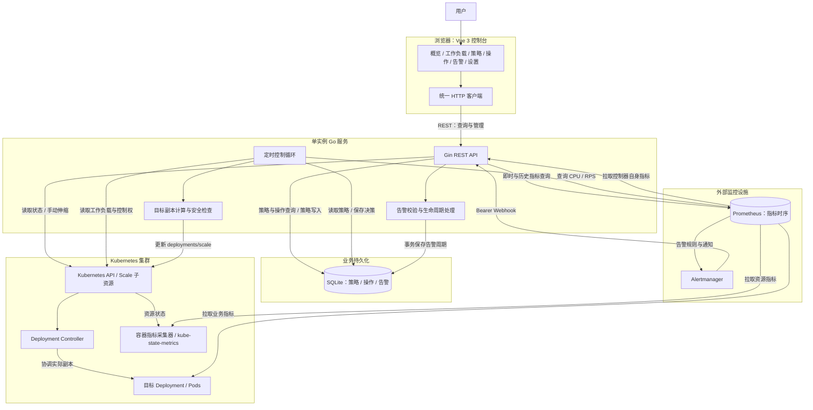
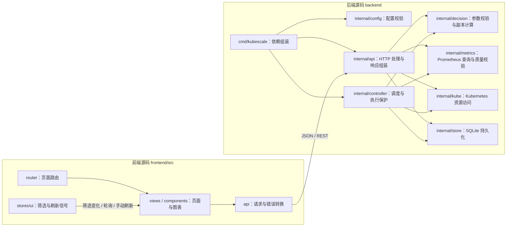
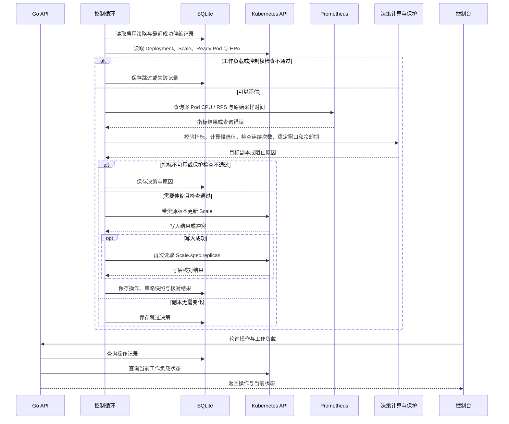

# 架构与边界

## 项目定位

KubeScale 是面向单个 Kubernetes 集群的 Deployment 弹性伸缩与可观测性平台。控制台负责策略管理、状态展示和决策追溯；Go 服务负责指标查询、伸缩控制和告警接收；Kubernetes 负责实际的 Pod 调度与生命周期管理。

当前采用单实例 Go 服务和 SQLite，API 与控制循环在同一进程中运行。下面的模块表示代码职责，并非独立微服务。所有业务数据来自真实后端，页面每 30 秒轮询并支持手动刷新。

## 整体架构图

图中的监控设施需要单独部署和配置。Prometheus 主动抓取指标并按外部规则向 Alertmanager 发送告警，后者向 KubeScale 发送通知；仓库当前只提供 ServiceMonitor 样例，尚未提供完整监控告警规则与通知路由。

平台有三条主要数据链路：查询链路将集群状态、时序指标和持久化记录组合后返回控制台；控制链路从策略与指标计算副本并调用 Scale API；告警链路只处理通知与告警状态，不参与副本决策。浏览器不直接访问 Kubernetes、Prometheus 或 SQLite。

## 应用内部结构

`main.go` 加载配置，创建 SQLite、Kubernetes 和 Prometheus 客户端，再将同一组依赖交给 API 与控制器。API 和控制循环并发运行，共享策略与操作数据；两者之间没有消息队列。`decision` 负责纯校验和计算，网络访问与状态协调由调用方承担。`internal/model` 定义跨模块业务对象，与前端 `types.ts` 对齐。

前端通过 `src/api/index.ts` 统一发起请求，页面以响应更新表格和 ECharts。Pinia 保存命名空间、时间范围、主题和刷新信号；策略提交携带 version，服务端拒绝过期版本。SSE 尚未实现，当前使用轮询。

## 数据归属与一致性

| 数据 | 来源 / 存储 | 说明 |
| --- | --- | --- |
| Deployment、Pod、Ready、Scale、HPA | Kubernetes API | 即时资源与控制权判断的依据 |
| CPU、RPS、历史曲线 | Prometheus | 决策检查逐 Pod 覆盖与原始采样时间，历史图表单独查询 |
| 策略 | SQLite `policies` | 保存配置、启用状态和版本；同一 Deployment 最多一条 |
| 操作与决策 | SQLite `operations` | 保存执行/跳过/失败、策略快照、指标采样时间和副本核对结果 |
| 告警触发周期 | SQLite `alerts` | 保存 firing/resolved、标签和起止时间，支持重启后查询 |
| 连续命中与缩容建议窗口 | 控制器内存 | 重启后重新累计；已成功伸缩的冷却时间从操作历史恢复 |

SQLite 业务对象采用 JSON document 保存，并有用于过滤和索引的列，启动时创建所需表。Kubernetes Scale 更新和 SQLite 记录写入不在同一事务中：副本变更、操作落库及 Pod Ready 是不同结果，不能相互等同。

## 伸缩闭环

每个 Deployment 最多保存一条策略，支持 CPU 或 RPS 目标值模式：

- CPU：`ceil(当前副本 × CPU 使用比例 / 目标比例)`。
- RPS：`ceil(总 RPS / 单 Pod 目标 RPS)`。

控制循环按策略采样周期读取 Deployment/Scale，检查就绪、滚动更新和 HPA 控制权；按 Deployment selector 获取 Ready Pod，核对指标覆盖与原始采样时间，再计算受上下限约束的候选副本。通过连续触发、缩容稳定窗口和冷却期检查后，带资源版本更新 Scale，并重新读取核对结果。

指标缺失、过期、非有限值、覆盖不全或依赖异常时保守跳过。只写 `deployments/scale`，不直接删除 Pod。手动伸缩要求先暂停自动策略，并检查控制权冲突。HPA 检查不代表能够识别所有外部控制器。

稳定窗口收集所有有效副本建议；重启后重新累计连续次数和稳定窗口，首次缩容需等待完整窗口。已完成伸缩的冷却时间从操作历史恢复。操作保存策略快照、版本、指标采样时间、判断原因及副本结果；写后核对的是 Scale.spec，Pod Ready 需单独观察。

### 自动伸缩时序

时序图表达单次协调的逻辑流程，末尾查询由同进程 API 独立处理。Kubernetes 在 Scale 写入后异步创建或回收 Pod，因此操作成功后仍需观察 Ready 状态。

## 告警闭环

Webhook 以 Bearer 密钥校验来源，按全部 labels 与 startsAt 标识一个触发周期。重复通知合并；resolved 为该周期终态，迟到 firing 不会重新激活；新 startsAt 代表再次触发。批量通知在同一事务提交，校验失败拒绝整批。namespace 必须在管理白名单内，workload 标签用于工作负载关联。

告警列表、详情和全量活动/严重统计由 API 提供，前端轮询刷新。告警与伸缩解耦。当前告警查询先读取再筛选分页，适合小规模单实例使用，尚无数据保留策略。

## 开发与部署拓扑

| 运行位置 | 组件 / 连接 | 当前方式 |
| --- | --- | --- |
| 浏览器 | Vue 控制台 | 默认访问 `127.0.0.1:5173`，通过 Vite `/api` 代理访问后端 |
| 开发主机 | Vite、Go 服务、SQLite 文件 | `scripts/dev.sh` 检查连接并启动前后端，默认 Go 监听 `127.0.0.1:8080` |
| 开发主机到集群 | Go → Kubernetes API | 使用 kubeconfig；集群内客户端也可使用 ServiceAccount 配置 |
| 监控环境 | Go → Prometheus | 通过配置 URL 访问；本地可手动 port-forward 到 `127.0.0.1:9090` |
| 告警来源 | Alertmanager → Go Webhook | 需要从 Alertmanager 所在网络可达的受保护后端地址，不能假定本地回环地址可达 |
| 集群资源 | 目标应用、指标采集与 RBAC | 样例分别在 `examples/demo-app/`、`deploy/monitoring/`、`deploy/rbac/` |

启动脚本不会部署集群、安装监控或创建端口转发。完整容器部署、前端静态资源托管和 SQLite PVC 方案尚未交付，不能将 Vite 开发入口视为生产部署方案。

## 运行与安全边界

- 默认监听 `127.0.0.1:8080`；非回环监听要求 `KUBESCALE_ALLOW_REMOTE=true` 且 Webhook 密钥非空。该密钥仅保护 Webhook。
- 管理 API 尚无用户身份认证与写权限控制；共享环境需受控代理或网络隔离。管理命名空间由 `KUBESCALE_NAMESPACES` 限定。
- RBAC 样例在 `deploy/rbac/`：资源读取与 Scale 写入按目标命名空间授权，节点读取单独授予集群只读权限。
- 当前无 SSE、多实例协调和高可用；部署目录仅有 RBAC 与 ServiceMonitor 样例，未提供完整镜像/PVC 部署包及备份恢复流程。
- Alertmanager 连通性探测未实现；真实通知路由和告警浏览器交互仍需环境联调。

## 维护边界

修改控制流程时，重点核对策略修改/暂停与协调循环并发时的版本和写入语义、连续触发中断及重启恢复。Scale 写入成功但核对或持久化失败时，需检查操作记录、冷却期和统计是否一致。

指标相关改动需保持 Deployment selector、Ready Pod、CPU Request、覆盖检查与采样新鲜度的口径一致。历史查询按现存 Pod 过滤，可能遗漏已删除 Pod；series 查询失败可能表现为空点集，不能据此认定没有历史数据。

告警改动需覆盖重复、恢复、迟到通知、再次触发、事务回滚和命名空间隔离。前端改动需检查并发请求、错误反馈、版本冲突、空指标展示及图表销毁；业务类型需同步核对 `frontend/src/types.ts` 与 `backend/internal/model/model.go`。

接口与指标细节分别见 [API](api.md)和[指标口径](metrics.md)，模块位置见[目录说明](project-structure.md)，开发检查命令见前后端 README。
