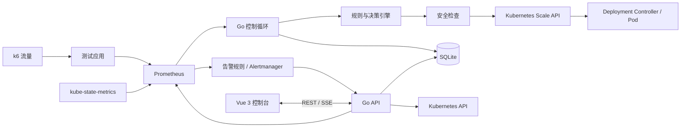

# KubeScale 项目设计

## 1. 目标与边界

KubeScale 面向 Kubernetes Deployment，提供 CPU 与业务请求量驱动的自动伸缩，以及相关状态、指标、决策和告警的统一查看。首版支持单个 Kubernetes 集群、单实例 Go 服务；只有被启用策略明确选中的 Deployment 才由 KubeScale 管理。

系统通过 `deployments/scale` 子资源修改副本数，不直接删除 Pod。Prometheus 保存指标历史，SQLite 保存业务数据。多实例部署、数据库迁移和高可用协调留待后续版本。

## 2. 业务闭环与组件

Go 服务包含 API、控制循环、指标查询、策略计算、Kubernetes 访问、持久化和事件推送。控制循环定期读取启用策略，查询指标，计算目标副本数，执行安全检查，调用 Scale API，再记录实际结果。API 向前端提供策略、工作负载、指标、事件和告警数据；SSE 推送新增事件。Alertmanager 通过 Webhook 将告警发送到 API。

## 3. 主要模块

| 模块 | 职责 |
| --- | --- |
| 指标查询 | 向 Prometheus 查询 CPU、RPS 和辅助观测指标；识别空值、过期值及查询失败。 |
| 策略与决策 | 解析策略、计算目标副本数、检查连续触发次数与上下限。 |
| 安全控制 | 检查冷却期、稳定窗口、滚动更新、Ready 状态、并发操作与控制权。 |
| Kubernetes 访问 | 读取 Deployment、Pod、Node 和 Event；通过 Scale API 读写副本。 |
| API 与 SSE | 管理策略，查询状态与历史，接收告警 Webhook，推送事件。 |
| 持久化 | SQLite 保存策略、决策记录和告警事件。 |
| 前端控制台 | 概览、工作负载、伸缩策略、操作记录、告警中心、系统设置。 |

工作负载详情包含概览、指标、自动伸缩、Pod 和事件视图。Grafana 用于开发验证，产品控制台直接展示核心图表。

## 4. 伸缩策略

### 4.1 首版指标

- **CPU 利用率**：工作负载内 Pod 的 CPU 使用量相对于 CPU Request 的百分比。没有有效 CPU Request 时不可使用该指标进行决策。
- **RPS**：工作负载的每秒 HTTP 请求数。示例 PromQL：`sum(rate(http_requests_total{namespace="autoscale-demo",app="demo-custom"}[1m]))`。应用须暴露相应指标且 Prometheus 能抓取。

首版每条策略选择一个决策指标（CPU 或 RPS）；一个 Deployment 同时只启用一条伸缩策略。内存、P50/P95/P99 延迟、5xx 错误率、Pod 重启、Pending/Ready Pod 和节点资源作为辅助观测指标，之后可扩展为决策指标。PromQL 由可信管理员配置，服务端限制查询范围、超时与结果类型。

### 4.2 计算与控制

CPU 目标值模式：`期望副本数 = ceil(当前副本数 × 当前 CPU 利用率 / 目标 CPU 利用率)`。RPS 按单 Pod 承载目标计算：`期望副本数 = ceil(当前总 RPS / 单 Pod 目标 RPS)`。两者均受最小与最大副本数约束。阈值步长模式可以作为后续策略类型：连续达到扩容或缩容阈值后，分别按配置步长调整。

控制循环依次进行：读取策略 → 查询指标 → 校验指标新鲜度 → 计算候选副本数 → 连续触发检查 → 冷却期检查 → 稳定窗口检查 → 健康及控制权检查 → 上下限检查 → 调用 Scale API → 核对结果 → 保存决策。未通过检查时记录跳过原因，不修改副本数。

策略字段包括：名称、命名空间、Deployment、指标类型、PromQL 或指标选择器、目标值、扩缩阈值、最小/最大副本数、连续触发次数、扩缩步长、采样间隔、冷却时间、稳定窗口和启用状态。采用目标值模式时，阈值与步长字段不参与计算；采用阈值步长模式时，目标值不参与计算，避免两套规则同时生效。

可供验证的阈值步长示例：每 15 秒采样；CPU 高于 70% 连续 3 次扩容 2 个副本，低于 30% 连续 5 次缩容 1 个副本；副本范围 1～8；冷却期 120 秒；缩容稳定窗口 300 秒。实际默认值应在实现时根据测试应用和集群容量确定。

### 4.3 安全约束

- 拒绝空值、非有限值、过期指标和 Prometheus 查询错误；指标不可用时保持副本数。
- 工作负载滚动更新中、Ready 副本不足或上次伸缩尚未完成时，暂缓下一次伸缩。
- 扩容与缩容分别统计连续命中；冷却期限制频繁操作，稳定窗口抑制短时缩容抖动。
- 读取最新 Scale 资源后更新，并处理资源版本冲突；记录期望值与实际观察值。
- 策略启用前检查同一 Deployment 是否已有 HPA 或其他副本控制者；存在冲突时拒绝接管并给出原因。人工暂停后不再自动写入副本数。
- 使用最小权限 RBAC，不授予 `cluster-admin`。

## 5. 指标与可观测性

Prometheus 查询覆盖 CPU、RPS；辅助展示内存使用率、请求延迟、错误率、Deployment 期望/当前/Ready/Available 副本、Pod 状态和重启次数、节点可分配与已请求资源。Kubernetes 对象状态来自 kube-state-metrics 或 Kubernetes API。

控制器自身暴露：`kubescale_reconcile_total`、`kubescale_reconcile_errors_total`、`kubescale_scaling_actions_total`、`kubescale_scaling_failures_total`、`kubescale_current_replicas`、`kubescale_desired_replicas`、`kubescale_last_scaling_timestamp`、`kubescale_metric_query_duration_seconds`、`kubescale_reconcile_duration_seconds`。标签限定为命名空间、工作负载、动作、状态、指标类型等低基数值，不使用 Pod UID 或错误文本作为标签。

Prometheus 告警规则判断异常，Alertmanager 负责分组、去重和通知；API 接收 Webhook、保存告警事件并通过 SSE 推送到前端。告警处理和伸缩决策解耦，告警不会直接触发副本变更。

## 6. 数据与接口

SQLite 计划包含以下表：

- `scaling_rules`：策略 ID、名称、namespace、workload_name、metric_type、promql、目标值、扩缩阈值、连续次数、步长、副本上下限、冷却与稳定窗口、enabled、创建和更新时间。
- `scaling_events`：事件 ID、rule_id、action、metric_value、old_replicas、desired_replicas、actual_replicas、reason、status、error_message、created_at。
- `alert_events`：事件 ID、告警名称、severity、namespace、workload_name、message、status、starts_at、ends_at、created_at。

REST API 规划为 `/api/v1/workloads`、`/api/v1/workloads/{namespace}/{name}`、`/api/v1/policies`、`/api/v1/operations`、`/api/v1/alerts`、`/api/v1/metrics/series`；`/api/v1/events/stream` 提供 SSE，`/api/v1/webhooks/alertmanager` 接收告警。字段、分页与错误约定见 [API 契约草案](api.md)，指标口径见[指标设计](metrics.md)。实现前应以 OpenAPI 固定契约。阶段二通过轮询与手动刷新更新数据，不实现 SSE、身份验证与权限控制；上述 SSE 能力保留为后续设计。Webhook 必须配置鉴权或网络访问限制；前端 API 需身份验证与策略写操作授权。

## 7. Kubernetes 部署

| 命名空间 | 计划部署内容 |
| --- | --- |
| `monitoring` | Prometheus、Alertmanager、Grafana、kube-state-metrics。 |
| `kubescale-system` | 单实例 Go 服务、Vue 前端、ServiceAccount、RBAC、SQLite PVC。 |
| `autoscale-demo` | 暴露 HTTP 与 Prometheus 指标的测试应用、Service。 |
| `load-test` | k6 测试任务。 |

Go ServiceAccount 对目标命名空间的 Deployment、Pod、Event、ReplicaSet 和 HorizontalPodAutoscaler 需要只读权限，以读取状态并检查控制权冲突；读取节点时单独配置集群级只读权限；对 `deployments/scale` 仅授予 `get`、`update`、`patch`。写入权限应按允许管理的命名空间收敛。部署配置在 `deploy/` 中维护，本地环境和演示资源在 `examples/` 中维护。

## 8. 版本演进

首版使用单实例 Go 服务和 SQLite，避免多个控制循环同时对同一目标写入。需要多副本高可用时，再评估 PostgreSQL、Leader Election、任务所有权及共享事件分发。每个阶段的交付物见[阶段计划](roadmap.md)。
