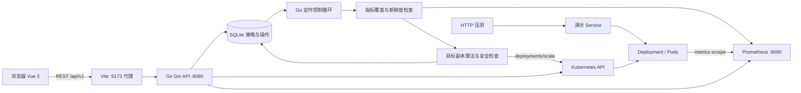

# 前后端架构与代码 Review 入口

本文描述当前实现，不将 `architecture.md` 中规划的能力视为已经实现。

## 运行拓扑

API 和控制循环在同一个 Go 进程中，复用 SQLite、Kubernetes Client、Prometheus Client。浏览器只请求 Go API，不直接访问集群或 Prometheus。开发环境中 Prometheus 通过 kubectl 转发到本机；前端容器使用 host 网络，所以 Vite 能代理到宿主机 8080。

## 前端结构

| 文件 | 职责与 review 关注点 |
| --- | --- |
| `frontend/src/main.ts` | 创建 Vue 应用，注册 Pinia、Router 和 Element Plus。 |
| `frontend/src/App.vue` | 导航、全局布局、命名空间筛选、刷新入口。 |
| `frontend/src/router/index.ts` | 概览、工作负载、策略、操作、告警及设置路由，页面懒加载。 |
| `frontend/src/stores/ui.ts` | Namespace、主题、时间范围、刷新信号；阶段一使用 30 秒轮询。 |
| `frontend/src/api/index.ts` | 唯一业务 HTTP 入口；`VITE_USE_MOCK=false` 才调用真实后端。 |
| `frontend/src/types.ts` | API DTO、指标单位、质量、策略和操作类型。 |
| `frontend/src/policy.ts` | 前端策略输入校验，不能代替后端校验。 |
| `frontend/src/views/WorkloadDetailView.vue` | 当前副本/CPU/RPS、指标趋势、自动伸缩、Pod 和事件；并发请求后组装视图。 |
| `frontend/src/views/PoliciesView.vue` | 策略配置与启停，提交 version 实现并发更新检查。 |
| `frontend/src/views/OperationsView.vue` | 成功/失败/跳过列表、时间线和操作详情。 |
| `frontend/src/components/MetricChart.vue` | ECharts 实例、单位显示、事件标记、ResizeObserver 与销毁。 |
| `frontend/src/mock/data.ts` | 独立 Mock 数据源，当前运行未启用。 |
| `frontend/vite.config.ts` | `/api` 代理到 `http://127.0.0.1:8080`。 |

页面数据流：页面 mounted / 筛选变化 / Pinia refreshKey → API 模块 → Go API → DTO → Vue ref → 表格和 ECharts。后端尚无 SSE，因此“事件流断开”表示使用轮询，不代表 REST 或控制器断开。历史图表依赖 Prometheus，操作记录依赖 SQLite。

## 后端结构

| 文件 | 职责与 review 关注点 |
| --- | --- |
| `backend/cmd/kubescale/main.go` | 依赖组装，启动控制循环与 HTTP 服务，处理退出信号。 |
| `backend/internal/config/config.go` | 环境变量、管理命名空间、超时、指标最大年龄、只允许回环监听。 |
| `backend/internal/api/server.go` | Gin 路由，工作负载/Pod/概览/系统状态组装，命名空间限制。 |
| `backend/internal/api/policies.go` | CRUD、指标预检、唯一目标检查、HPA 冲突检查、version 校验。 |
| `backend/internal/api/operations.go` | 操作记录与手动伸缩；自动策略启用时拒绝手动写副本。 |
| `backend/internal/api/series.go` | 历史图表 PromQL、24 小时范围上限和采样步长；查询失败时返回空点集。 |
| `backend/internal/controller/controller.go` | 周期调度、单策略协调、连续命中/冷却/稳定窗口、Scale 写入及核对、操作与自身指标。 |
| `backend/internal/decision/decision.go` | 策略参数校验和纯副本计算，不执行网络或数据库操作。 |
| `backend/internal/metrics/prometheus.go` | 即时与范围查询、逐 Pod 覆盖、原始样本新鲜度、空值和非有限值检查。 |
| `backend/internal/kube/client.go` | client-go，Deployment/Pod/Scale/HPA，Ready Pod 与 CPU Request 提取。 |
| `backend/internal/store/sqlite.go` | 初始建表、策略唯一性、版本更新、操作分页、上次成功伸缩时间。 |
| `backend/internal/model/model.go` | 业务模型和 JSON 字段，与前端 types.ts 对照阅读。 |
| `backend/cmd/demo-app/main.go` | 演示 HTTP 处理、CPU 计算负载、请求计数和延迟直方图。 |

当前 SQLite 表是 `policies` 与 `operations`，核心对象保存为 JSON document，另有用于过滤和索引的列；并非设计文档规划的三张最终业务表。告警真实接口目前返回空列表。

## 两条核心调用链

### 创建/修改策略

浏览器 PoliciesView → `api.createPolicy/updatePolicy` → Gin handler → 参数与命名空间校验 → Deployment/HPA 检查 → SQLite（目标唯一约束、version 检查）→ JSON 返回 → 页面刷新。

### 自动伸缩

`Run` → `ReconcileAll` 查询启用策略并检查采样周期 → `Reconcile`：

1. 读取 Deployment 和 Scale，检查 Ready/更新状态、HPA。
2. 按 Deployment selector 获取 Ready Pod。
3. CPU：读取 Pod 规格 CPU Request，查询每个 Pod CPU 使用量；RPS：查询每个 Ready Pod 的请求速率。
4. 核对覆盖与采样新鲜度；异常时记录 skipped 并返回。
5. 计算目标副本：CPU 为 `ceil(current × utilization / target)`；RPS 为 `ceil(totalRps / targetPerPod)`，限制上下限。
6. 检查连续命中、缩容稳定窗口和历史冷却期。
7. 带读取到的 Scale 资源版本调用 UpdateScale，再 GetScale 核对 `spec.replicas`。
8. 保存 succeeded/failed/skipped 操作，更新控制器自身指标。

这里的“实际确认副本”是写后读取到的 Scale `spec.replicas`，不表示新 Pod 已经全部 Ready；Ready 状态要另外从 Kubernetes 查询。

## 建议阅读顺序与重点

先读 `types.ts` / `model.go` 对齐契约，再读 `main.go`，随后沿 `controller.go → decision.go → metrics → kube → store` 阅读闭环；最后从 `WorkloadDetailView.vue → api/index.ts → API handler` 检查页面数据流。

建议特别检查这些边界，已通过的功能测试不等于全部边界都已覆盖：

- 策略暂停/修改与正在执行的 Reconcile 之间的并发语义，version 是否覆盖所有写入场景。
- 缩容稳定窗口如何收集历史建议；重启后内存中的连续计数和稳定窗口如何恢复。
- Scale 写入成功而核对/持久化失败时，日志、冷却期和动作统计是否一致。
- CPU/RPS 对 Pod、容器、Deployment selector 和同名 app 的边界。
- 历史 CPU/RPS 当前用现存 Pod 名称过滤，已删除 Pod 的历史可能被遗漏；历史图表与即时决策使用不同查询路径。
- series 查询失败被转换为空点集，页面能否区分“无数据”和“查询失败”。
- 页面并发请求失败、轮询重新加载、图表初始化及容器尺寸变化的行为。
- 当前没有身份认证和写操作授权，只适用于本机回环调试；单进程 SQLite，未实现多实例协调。

## 可视化观察入口

- 控制台：`http://127.0.0.1:5173/`
- 目标详情：`http://127.0.0.1:5173/workloads/autoscale-demo/demo-custom`
- 操作记录：`http://127.0.0.1:5173/operations`，筛选成功可以观察真实副本变化。
- Prometheus：`http://127.0.0.1:9090/`，可查询 `sum(rate(http_requests_total{namespace="autoscale-demo"}[1m]))`。
- 后端健康：`http://127.0.0.1:8080/healthz`；控制器指标：`http://127.0.0.1:8080/metrics`。

详情页切换“指标”查看 CPU、RPS 和期望/Ready 副本。页面每 30 秒刷新，也可手动刷新。按实际演示时间选择时间范围。注意已删除 Pod 的历史查询边界。

`scripts/review-live-demo.py` 会复用演示策略并改为 RPS 目标 10、范围 1～3，进行两轮“90 秒升压 + 150 秒无流量”，结束后暂停策略并恢复 Service 为 ClusterIP。控制台手动暂停策略也会终止演示。它只重放正常伸缩场景，不重放断开 Prometheus 的故障场景。

## 远程开发访问

服务运行于远程主机时，可以在 VS Code 的端口面板转发前端端口 5173，
通过显示的本地地址访问。浏览器请求由前端的 `/api` 代理转发到后端，
后端保持回环监听。容器、数据库位置和虚拟机地址以各自环境配置为准。
